# Bank Account and Transaction Management System

**Project 55 · DBMS Project-Based Learning (PBL)**
M. Srilakshmi Reddy · AI-ML · Woxsen University · 2026

A relational database system in MySQL 8, normalized to 3NF, for managing bank customers, accounts, transactions, transfers and loans. Business rules are enforced inside the database (3 triggers, 11 CHECK constraints, 2 stored procedures), and a web application sits on top of it.

> ### ▶ [Try it now: live demo (no install)](https://srilakshmireddy-byte.github.io/bank-dbms-pbl/)
> Opens in any browser and runs on built-in sample data, so no database is needed. Pick a demo login on the sign-in page (Teller, Loan Officer or Manager); everything resets when you reload. The full MySQL-backed version is under [Run the prototype](#run-the-prototype) below.

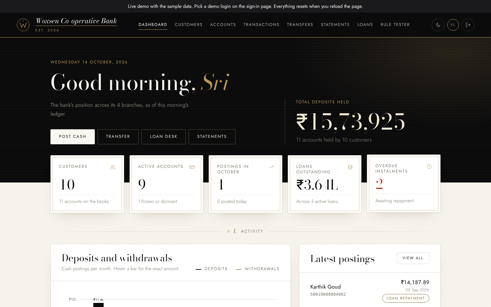

| | |
|---|---|
| **Live demo** | [srilakshmireddy-byte.github.io/bank-dbms-pbl](https://srilakshmireddy-byte.github.io/bank-dbms-pbl/) (sample data runs in the browser) |
| **Working prototype** | [`review-3/`](./review-3) |
| **Final report** | [`report/Final_Report.pdf`](./report/Final_Report.pdf) |
| **Video presentation (5 min)** | see [`video/VIDEO_LINK.md`](./video/VIDEO_LINK.md) |
| **ER diagram** | [below](#er-diagram), and [`docs/er_diagram.png`](./docs/er_diagram.png) |

## Submission contents

| Item | Location |
|---|---|
| Review 1 deck (PDF) | [`review-1/Project55_Review1_Deck.pdf`](./review-1/Project55_Review1_Deck.pdf) |
| Review 2 deck (PDF) | [`review-2/Project55_Review2_Deck.pdf`](./review-2/Project55_Review2_Deck.pdf) |
| Normalization and data dictionary | [`review-2/Review2_Normalization_and_Data_Dictionary.md`](./review-2/Review2_Normalization_and_Data_Dictionary.md) |
| SQL scripts (schema, triggers, data, views, queries) | [`review-2/sql/`](./review-2/sql) |
| Validation tests | [`review-2/validation_tests.md`](./review-2/validation_tests.md) |
| ER diagram | below, and [`docs/er_diagram.png`](./docs/er_diagram.png) |
| Working prototype | [`review-3/`](./review-3) |
| Final report (PDF, DOCX) | [`report/Final_Report.pdf`](./report/Final_Report.pdf), [`report/Final_Report.docx`](./report/Final_Report.docx) |
| Video link document | [`video/VIDEO_LINK.md`](./video/VIDEO_LINK.md) |
| HackerRank profile report | [`hackerrank/`](./hackerrank) |
| LeetCode profile report | [`leetcode/`](./leetcode) |

## ER diagram

Rendered from the implemented schema (`review-2/sql/01_schema.sql`). 14 tables, 17 foreign keys.

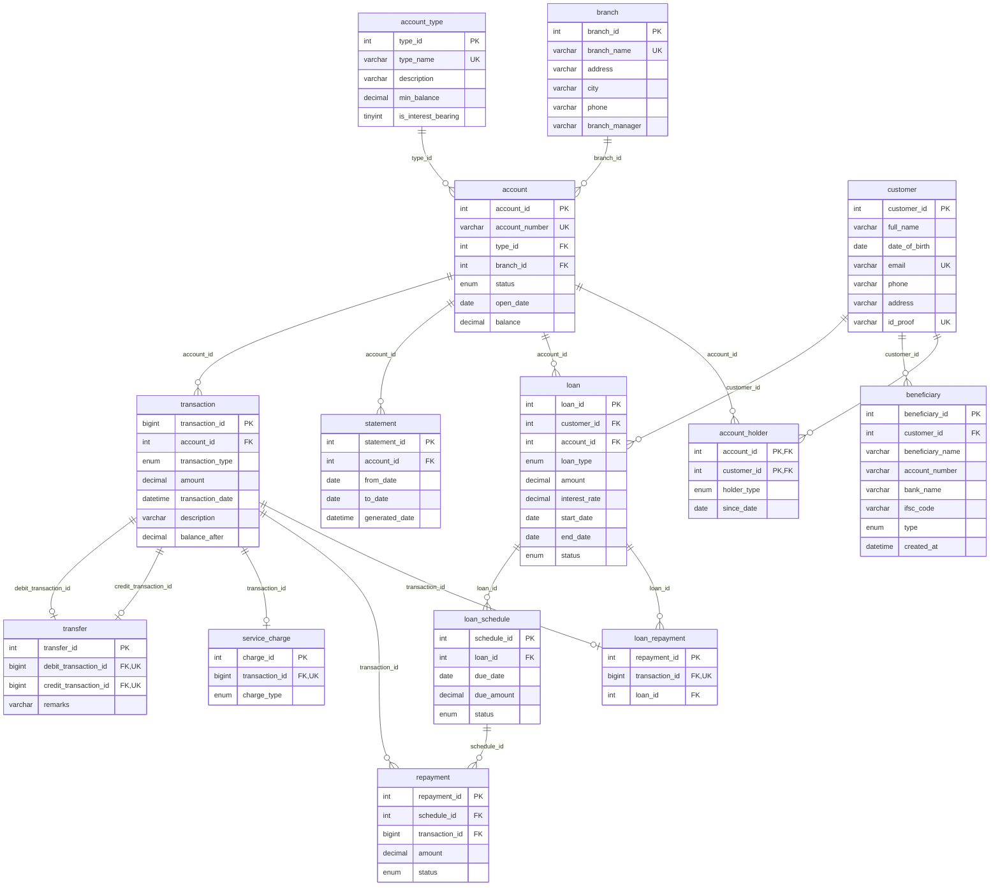

## Screenshots

All captured from the running prototype and the live MySQL database (`review-3/screenshots/`).

**Sign in**

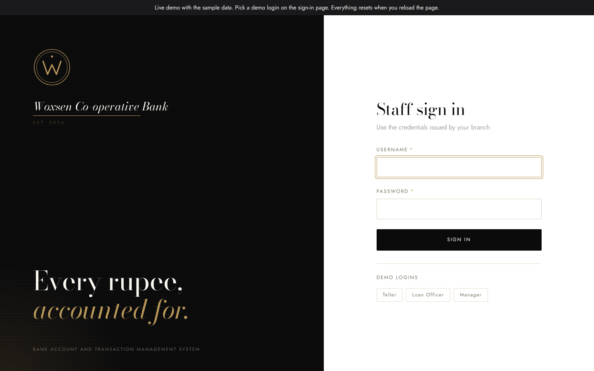

**Dashboard**


**Accounts**

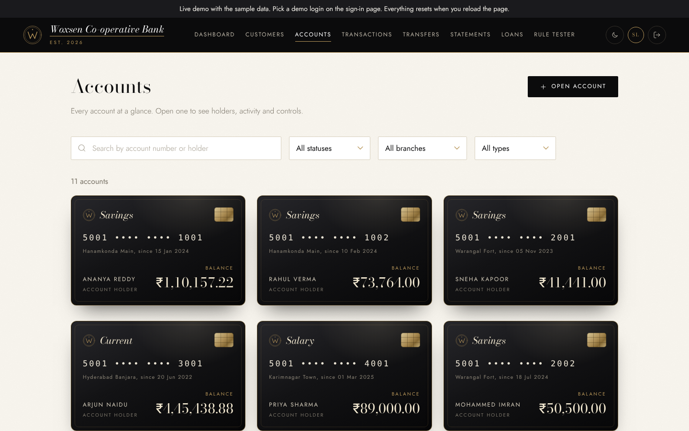

**Transfers (debit and credit posted together)**

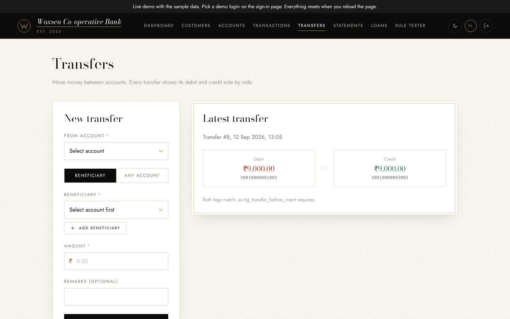

**Loans**

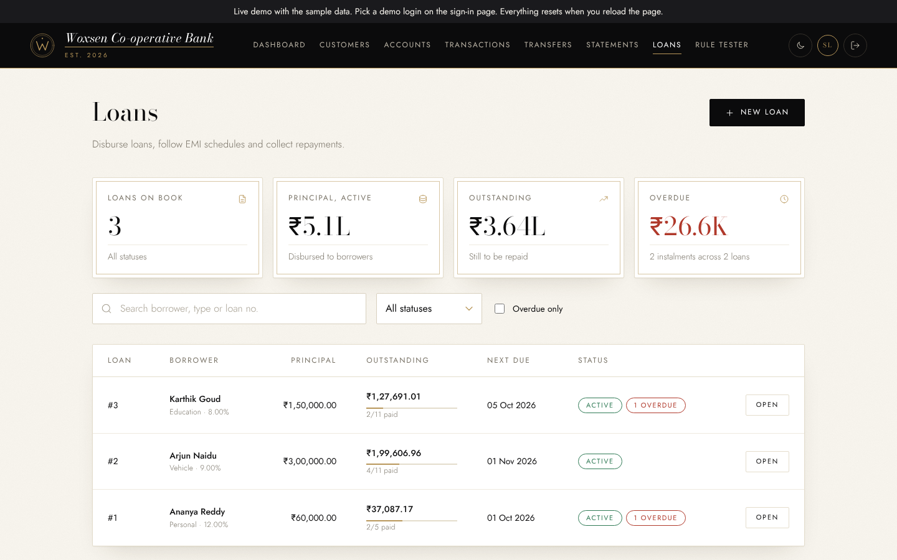

**Statements**

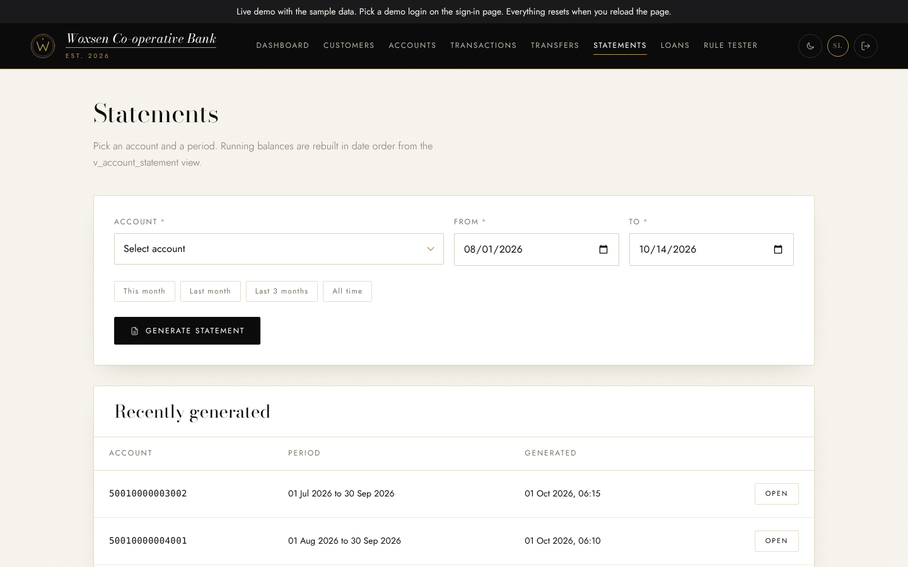

**Rule Tester: illegal operations refused by the database**

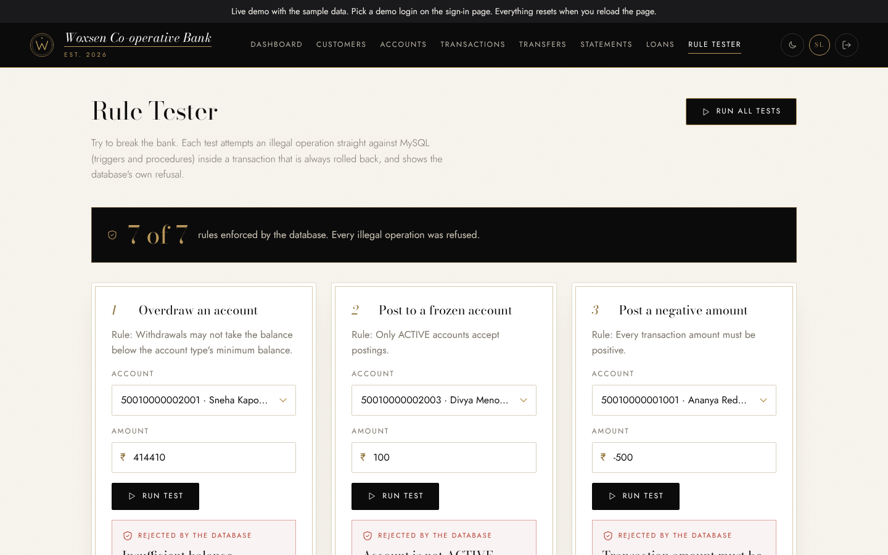

**Database: 14 tables**

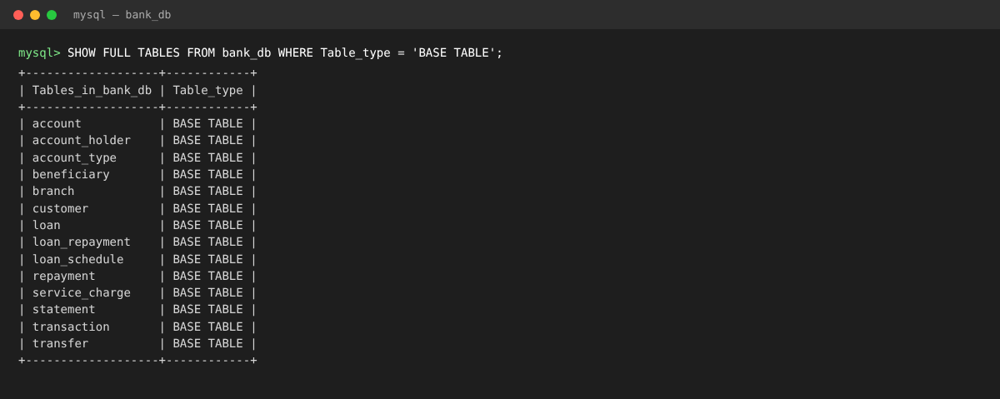

**Database: views v_loan_outstanding and v_branch_summary**

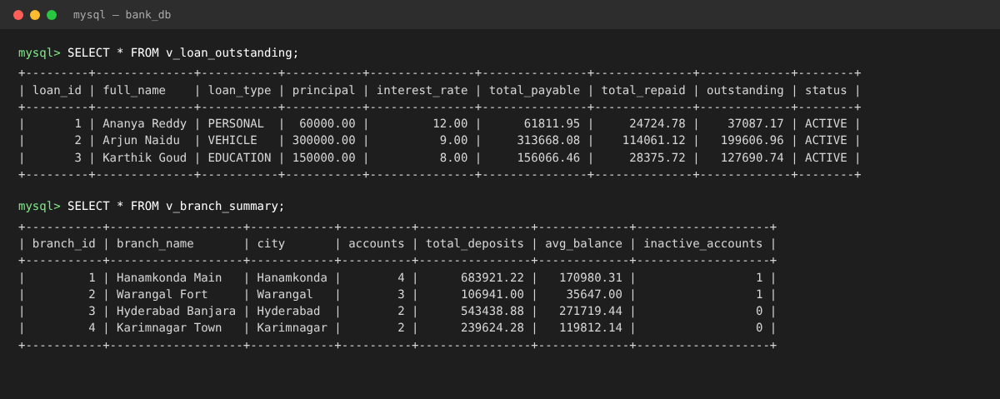

**Database: triggers reject an overdraw, a frozen-account posting and a negative amount, and balances stay unchanged**

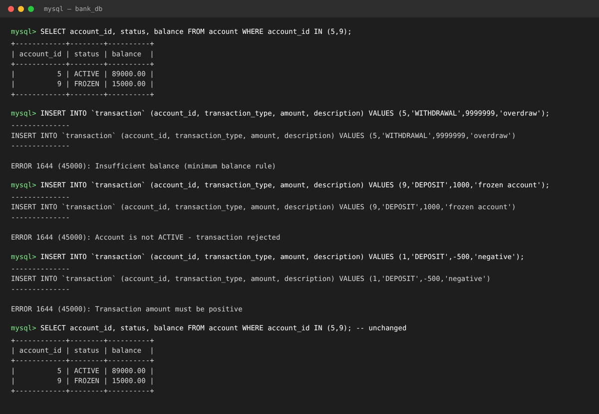

**Database: triggers and stored procedures**

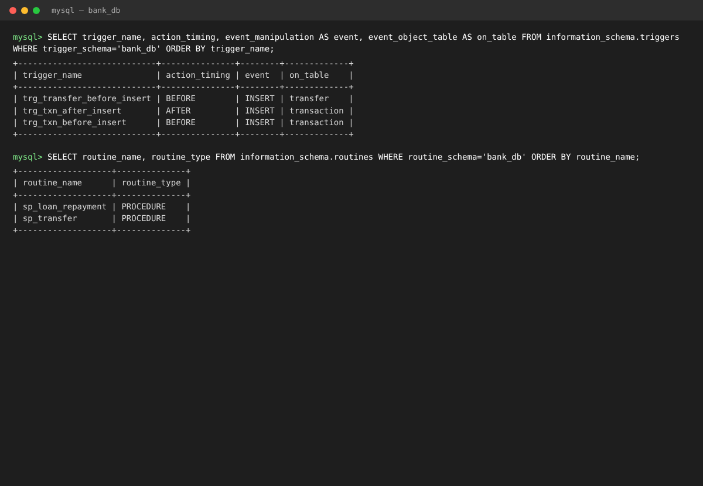

## Repository layout

```
review-1/   problem statement, scope, users and requirements, ER diagram, initial schema (deck PDF)
review-2/   normalization, data dictionary, DDL, triggers, sample data, queries (deck PDF + sql/)
  sql/        01_schema.sql ... 05_queries.sql, queries_output.txt
review-3/   the working prototype (Node.js + Express + MySQL back end, plain HTML/CSS/JS front end)
  db/         bank_review2.sql (full database script)
  routes/ lib/ middleware/ public/ scripts/ test/ screenshots/
report/     final report (PDF and DOCX)
video/      link to the 5-minute video presentation
hackerrank/ HackerRank profile report
leetcode/   LeetCode profile report
docs/       ER diagram
.github/    GitHub Pages workflow that publishes the live demo
```

## Design highlights

- **3NF** with two documented, trigger-maintained derived columns (`account.balance` and `transaction.balance_after`).
- **Business rules in the database:** amounts must be positive, debits cannot go below the account type's minimum balance, only ACTIVE accounts accept postings, a transfer's debit and credit legs must match, and a transfer cannot go to the same account.
- **7 reporting views:** account balances, account statement, transaction audit, transfers, loan outstanding, repayment history and branch summary.
- **Atomic operations:** `sp_transfer` and `sp_loan_repayment` run as one transaction with rollback, and all SQL in the app is parameterized.

## Run the prototype

Requirements: MySQL 8 and Node.js 18 or newer.

```bash
cd review-3

# 1. Create the database (drops and recreates bank_db with the sample data)
mysql -u root -p < db/bank_review2.sql

# 2. Install dependencies
npm install

# 3. Configure: copy the template, then edit .env yourself (DB_PASSWORD, JWT_SECRET)
cp .env.example .env

# 4. Start, then open http://localhost:3000
npm start
```

Demo staff logins (Teller, Loan Officer, Manager), the API summary are in [`review-3/README.md`](./review-3/README.md). Run the tests with `npm test`.

## Run the SQL on its own

```bash
cd review-2/sql
for f in 01_schema 02_triggers 03_sample_data 04_views_reports; do mysql -u root -p < $f.sql; done
mysql -u root -p -t < 05_queries.sql
```
